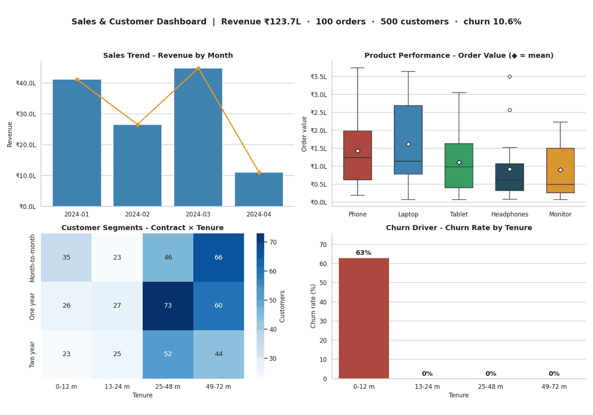
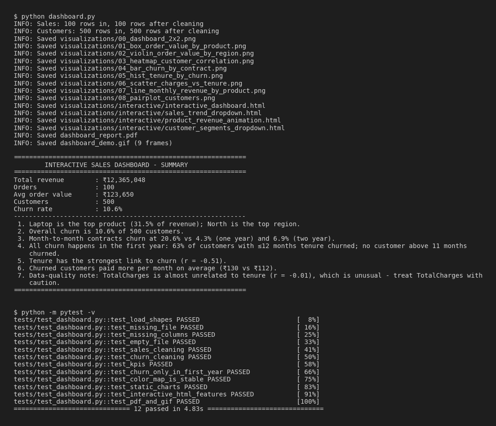

# Week 6 – Interactive Sales Dashboard

A sales and customer dashboard built with **Seaborn** for statistical charts and **Plotly** for interactive charts. It covers sales trends, product performance, customer segmentation and churn.



## Project Overview

**Goal:** turn two raw datasets into a dashboard that answers:

1. How are sales trending month by month?
2. Which products and regions perform best, and how spread out are their order values?
3. What customer segments exist (contract × tenure)?
4. What drives customer churn?

**Data**

| File | Rows | Used for |
|---|---|---|
| `data/sales_data.csv` | 100 orders, 1 Jan – 9 Apr 2024 | Sales trend, product & region performance |
| `data/customer_churn.csv` | 500 customers | Customer segmentation & churn |

Both datasets were provided with the task. They are separate (they share no customer IDs), so the sales panels and the customer panels are analysed side by side, not joined.

**Headline numbers**

| Metric | Value |
|---|---|
| Total revenue | ₹1,23,65,048 |
| Orders · average order value | 100 · ₹1,23,650 |
| Top product · top region | Laptop (31.5% of revenue) · North |
| Customers · churn rate | 500 · 10.6% |
| Churn: month-to-month / one year / two year | 20.6% / 4.3% / 6.9% |
| Churn in first 12 months of tenure | 63% (no customer with more than 11 months churned) |

## Setup Instructions

1. Install Python 3.9+.
2. Clone and enter the project:
   ```bash
   git clone https://github.com/surajsuman23/week6-interactive-sales-dashboard.git
   cd week6-interactive-sales-dashboard
   ```
3. (Optional) virtual environment:
   ```bash
   python -m venv venv
   source venv/bin/activate        # Windows: venv\Scripts\activate
   ```
4. Install dependencies:
   ```bash
   pip install -r requirements.txt
   ```
5. Build the whole dashboard (charts, interactive HTML, PDF, GIF):
   ```bash
   python dashboard.py
   ```
6. Or follow it step by step in the notebook:
   ```bash
   jupyter notebook dashboard.ipynb
   ```
7. Run the tests:
   ```bash
   python -m pytest -v
   ```

**Viewing the interactive charts:** download or clone the repo and double-click any file in `visualizations/interactive/` to open it in your browser. GitHub only shows HTML files as source code, so they must be opened locally. They load Plotly from a CDN, so you need an internet connection.

## Code Structure

```
week6-interactive-sales-dashboard/
├── README.md
├── dashboard.py                 # full pipeline: load → clean → KPIs → charts → HTML → PDF → GIF
├── dashboard.ipynb              # step-by-step notebook (Day 1 → Day 7), executed with outputs
├── dashboard_demo.gif           # walkthrough of the dashboard panels
├── requirements.txt
├── pytest.ini
├── data/
│   ├── sales_data.csv
│   └── customer_churn.csv
├── visualizations/
│   ├── 00_dashboard_2x2.png                    # 2×2 dashboard grid
│   ├── 01_box_order_value_by_product.png       # box plot
│   ├── 02_violin_order_value_by_region.png     # violin plot
│   ├── 03_heatmap_customer_correlation.png     # correlation heatmap
│   ├── 04_bar_churn_by_contract.png            # bar chart with 95% CI
│   ├── 05_hist_tenure_by_churn.png             # histogram + KDE
│   ├── 06_scatter_charges_vs_tenure.png        # scatter + regression line
│   ├── 07_line_monthly_revenue_by_product.png  # line chart
│   ├── 08_pairplot_customers.png               # pair plot
│   └── interactive/
│       ├── interactive_dashboard.html          # combined 2×2 dashboard + region dropdown
│       ├── sales_trend_dropdown.html           # metric dropdown (revenue/orders/units)
│       ├── product_revenue_animation.html      # animated bar chart, ▶ Play + month slider
│       └── customer_segments_dropdown.html     # contract dropdown + rich hover
├── report/
│   └── dashboard_report.pdf     # 10-page PDF: KPIs, insights, every chart
├── screenshots/
│   └── terminal_output.png      # program run + test results
└── tests/
    └── test_dashboard.py        # 12 pytest tests
```

### Main functions in `dashboard.py`

| Step | Function(s) | What it does |
|---|---|---|
| Load & clean | `load_sales()`, `load_churn()` | Validates columns, trims text, fixes casing, converts types (bad values → NaN), removes duplicates and invalid rows, recomputes `Total_Sales`, adds `Month`, `Churn_Label`, `Tenure_Group` |
| KPIs | `compute_kpis()` | Revenue, orders, top product/region, churn rates by contract and tenure, correlations |
| Theme | `apply_theme()`, `PALETTE`, `color_map()` | One custom palette for every chart; each product/region keeps the same colour everywhere |
| Static charts | `chart_*()` | Nine Seaborn charts, including the 2×2 dashboard |
| Interactive | `interactive_*()` | Four Plotly HTML files (hover, dropdowns, animation, slider) |
| Report | `write_pdf_report()`, `make_demo_gif()`, `insights()` | PDF report, demo GIF, data-driven insight text |

## Technical Requirements – how each is met

| Requirement | Where |
|---|---|
| Seaborn statistical plots | box, violin, heatmap, bar with CI, histogram + KDE, scatter + regplot, line, pair plot |
| At least 5 chart types | 8 distinct types (above) + Plotly line, bar, scatter, subplot dashboard |
| Statistical annotations | Mean (◆) and median labels on box/violin; 95% CI on churn bars; group sizes (n) |
| Interactive elements with Plotly | Hover tooltips on every chart; 3 dropdown menus; animated bar chart with Play/Pause and slider |
| Cohesive colour scheme | `PALETTE` + `color_map()`; churn is always red, stayed always blue |
| Professional dashboard layout | `00_dashboard_2x2.png` and `interactive_dashboard.html` (2×2 grids with KPI header) |
| PDF report | `report/dashboard_report.pdf` |
| Error handling | Custom `DataValidationError`; missing file/columns/empty data give clear messages; `errors="coerce"` on type conversion |

## Dashboard Guide – how to read each visualization

**00 · 2×2 Dashboard.** This is the one-page summary.
- **Top-left, sales trend:** revenue by month. February (₹26.6L) dipped and March (₹44.9L) was the best month. April has only 9 days of data, so its bar is not comparable with the other months.
- **Top-right, product performance:** order-value boxes per product.
- **Bottom-left, customer segments:** customer counts by contract type and tenure band. The largest segment is one-year contracts at 25–48 months (73 customers).
- **Bottom-right, churn driver:** churn rate per tenure band. All churn sits in the first 12 months.

**01 · Box plot – order value by product.** Each box spans the middle 50% of orders, the line inside is the median, ◆ is the mean, and the dots are individual orders.
- Phone has the highest median order (₹1.24L) and Laptop the highest mean (₹1.62L).
- Laptop's mean is far above its median, so a few very large laptop orders lift its revenue.
- Headphones and Monitors have low medians (₹0.62L and ₹0.49L). Headphones has two outlier orders above ₹2.5L.

**02 · Violin plot – order value by region.** The width shows where orders cluster, and the dashed lines are quartiles.
- East has the highest median (₹1.36L), though from only 19 orders.
- West has a much lower median (₹0.44L) and is wide at the bottom: most of its orders are small. This is why West is the weakest region despite 26 orders.

**03 · Correlation heatmap – customer metrics.** Red means a positive relationship and blue a negative one.
- **Tenure ↔ Churn, r = −0.51:** the strongest relationship. Longer-tenure customers rarely leave.
- **MonthlyCharges ↔ Churn, r = 0.11:** weak. Higher bills slightly increase churn.
- **Data-quality note:** TotalCharges is almost uncorrelated with tenure (r = −0.01). In real billing data it would grow with tenure, so TotalCharges is not used for conclusions.

**04 · Bar chart – churn rate by contract.** Bars are split senior vs non-senior; the black lines are 95% confidence intervals.
- Month-to-month customers churn about 3–5× more than contract customers: 20.6% vs 4.3% (one year) and 6.9% (two year).
- Senior and non-senior rates are similar and their CIs overlap heavily, so senior status is not a meaningful driver.

**05 · Histogram + KDE – tenure, stayed vs churned.**
- Every churned customer (red) has 11 months of tenure or less. Beyond the 12-month line, no one churned.
- This is the clearest finding in the dashboard: **the first year is the risk window**.

**06 · Scatter + regression – monthly charges vs tenure.**
- The trend line is almost flat (r = −0.06), so newer customers are not charged differently.
- Churned customers (red) cluster at low tenure and tend toward higher monthly charges.

**07 · Line chart – monthly revenue by product.**
- Laptop is the most volatile: ₹19.8L in January, ₹2.9L in February, then ₹15.2L in March.
- Tablet is the steadiest product.
- There were no Phone orders in April's 9 days, so the Phone line stops at March.

**08 · Pair plot – customer variables.** It shows every pair of tenure, monthly charges and total charges, coloured by churn.
- It confirms the tenure split: churners sit in a narrow band at the far left of the tenure axis.
- The other pairs show no clear pattern.

**Interactive charts** (in `visualizations/interactive/`)
- **`interactive_dashboard.html`:** the 2×2 dashboard with hover values. The **Region** dropdown (top-right) filters the two sales panels (All, East, North, South, West). The customer panels always show all 500 customers.
- **`sales_trend_dropdown.html`:** the **Metric** dropdown switches between Revenue, Orders and Units per product per month. Hover to see exact values.
- **`product_revenue_animation.html`:** press **▶ Play** to watch cumulative revenue build month by month, or drag the slider. Laptop pulls ahead from January.
- **`customer_segments_dropdown.html`:** tenure vs monthly charges for each customer. Hover to see ID, contract and payment method. The **Contract** dropdown filters the points and shows the churn rate for that segment in the title.

**`dashboard_demo.gif`:** a slideshow of the nine dashboard panels, 1.5 seconds each. It is built from the rendered chart images, not a screen recording; open the HTML files to try the interactive features.

## Key Insights & Recommendations

1. **The first year decides retention.** 63% of customers with 12 months or less of tenure churned, and none with more than 11 months did. Focus onboarding and retention offers on new customers.
2. **Month-to-month contracts churn 20.6%,** versus 4–7% on contracts. Offer incentives to switch to a one-year contract.
3. **Laptop drives revenue (31.5%)** through large orders, but its monthly revenue is volatile. Keep stock planning flexible.
4. **West has the smallest orders** (median ₹0.44L). Try bundles to raise order size there.
5. Churned customers paid somewhat more per month on average (₹130 vs ₹112), so it is worth checking pricing for new high-bill customers.

## Testing Evidence

`tests/test_dashboard.py` has 12 tests:

- **Loading and validation:** row counts, missing file, missing columns, empty file
- **Cleaning:** messy sales rows (whitespace, casing, duplicate, wrong total, bad date, zero quantity) and messy churn rows (duplicate ID, invalid churn flag, non-numeric tenure)
- **KPIs:** revenue, top product and region, churn rates and their ordering, churn only in the first year
- **Theme:** the same category always gets the same colour
- **Outputs:**
  - 9 PNG charts are created
  - the HTML files contain the dropdown menus, animation frames and custom hover templates
  - the PDF is valid and the GIF has one frame per chart and is under 2 MB

```
$ python -m pytest -v
============================== 12 passed ==============================
```



## Limitations

- **Sample size:** the sales data covers 100 orders over about 3.3 months, and April is partial. Trends are indicative only.
- **No join:** the sales and customer datasets share no IDs, so churn cannot be linked to purchases.
- **TotalCharges:** it does not track tenure, so it is excluded from conclusions.

## What I Learned

- Seaborn's statistical plots (box, violin, KDE, regplot, pairplot) and how to annotate them
- Keeping one colour per category across every chart makes a dashboard much easier to read
- Building Plotly dropdowns (`updatemenus`) and animations (`frames` + slider)
- Arranging a multi-panel dashboard with a KPI header and writing an interpretation for each chart
